<p align="center">
  <picture>
    <source media="(prefers-color-scheme: dark)" srcset="docs/assets/logo-dark.svg">
    
  </picture>
</p>

<p align="center">
  Your own GPU behind OpenAI- and Anthropic-compatible APIs, with the cloud one alias away.
</p>

<p align="center">
  <a href="https://github.com/lmgw-dev/lmgw/releases/latest"></a>
  <a href="https://github.com/lmgw-dev/lmgw/actions/workflows/ci.yml"></a>
  <a href="LICENSE.md"></a>
  
  
</p>

lmgw, short for local model gateway, is a Linux desktop app. It runs models on
your own GPU and serves them through local copies of the OpenAI and Anthropic
APIs, so tools and SDKs built for those services only need a new base URL. The
models live in Podman containers. llama.cpp handles text, while speech and
images go to audio.cpp and stable-diffusion.cpp, and each container starts
when a request needs it and shares the card under VRAM-aware scheduling. Cloud
providers (OpenAI-compatible, Anthropic, Gemini) plug in behind the same
aliases. Moving an alias from a local model to a cloud one goes unnoticed by
the client, and while the GPU is on hold, requests can fall back to the cloud.
It all runs from the system tray. The dashboard opens in its own window and
works remotely from a browser too.

The project site is at [lmgw-dev.github.io](https://lmgw-dev.github.io/). lmgw
also has clients of its own: [Kai](https://github.com/lmgw-dev/kai) for the
Plasma desktop, [Kai mobile](https://github.com/lmgw-dev/kai-mobile) for
Android and [Inkference](https://github.com/lmgw-dev/inkference) for Firefox
(see [Paired devices and clients](#paired-devices-and-clients)).

## Screenshots

<table>
  <tr>
    <td align="center" width="50%">
      <a href="docs/screenshots/overview.png">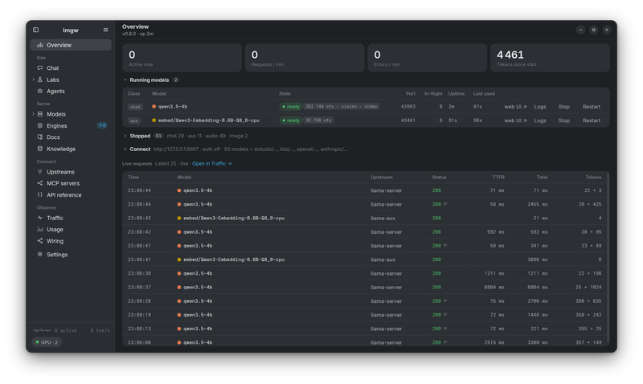</a><br>
      <sub><b>Overview</b> · running models and live requests</sub>
    </td>
    <td align="center" width="50%">
      <a href="docs/screenshots/chat.png">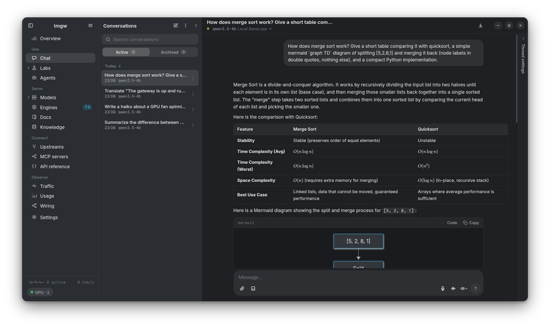</a><br>
      <sub><b>Chat</b> · any alias, with Markdown, math and Mermaid</sub>
    </td>
  </tr>
  <tr>
    <td align="center">
      <a href="docs/screenshots/models.png">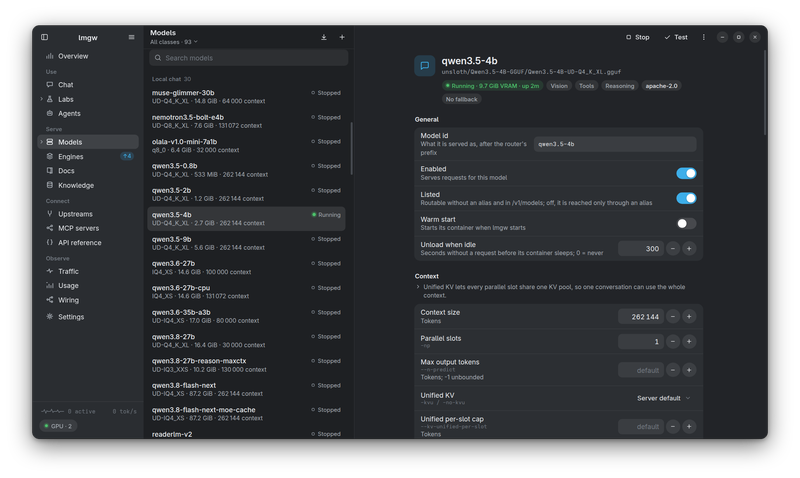</a><br>
      <sub><b>Models</b> · local models, aliases and upstream catalogs</sub>
    </td>
    <td align="center">
      <a href="docs/screenshots/usage.png">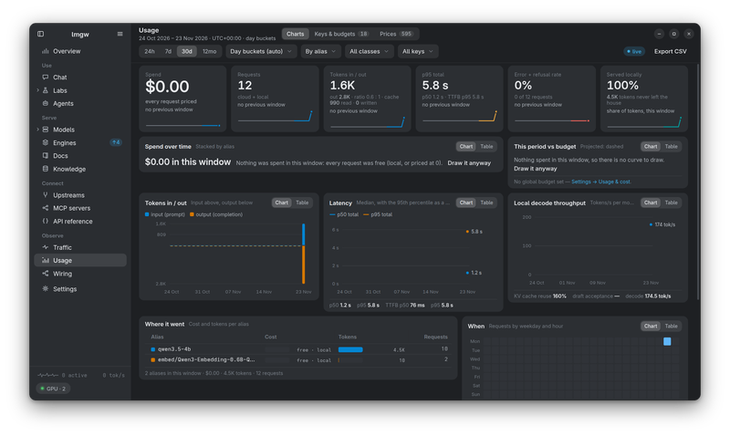</a><br>
      <sub><b>Usage</b> · tokens, latency, throughput and cost</sub>
    </td>
  </tr>
  <tr>
    <td align="center">
      <a href="docs/screenshots/traffic.png">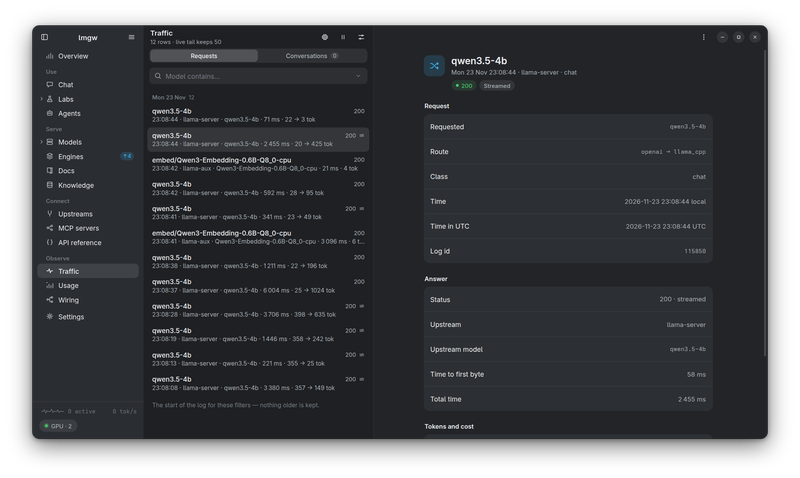</a><br>
      <sub><b>Traffic</b> · every request, across both API dialects</sub>
    </td>
    <td align="center">
      <a href="docs/screenshots/engines.png">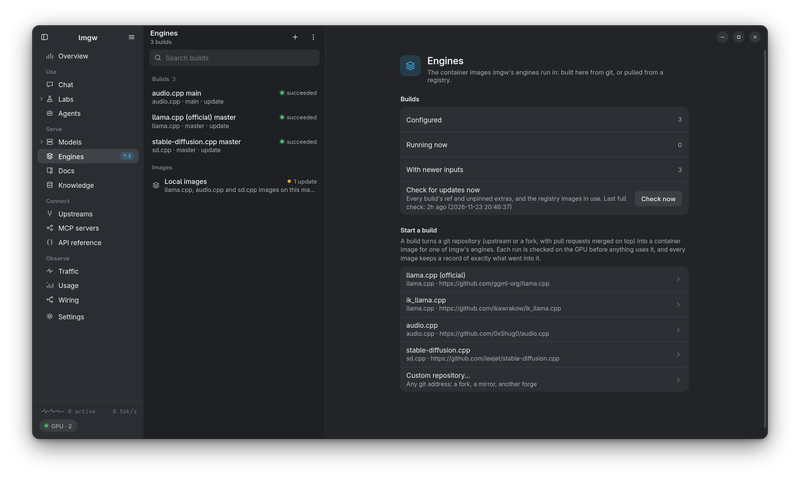</a><br>
      <sub><b>Engines</b> · llama.cpp, audio.cpp and sd.cpp images built from git</sub>
    </td>
  </tr>
  <tr>
    <td align="center">
      <a href="docs/screenshots/mcp-servers.png">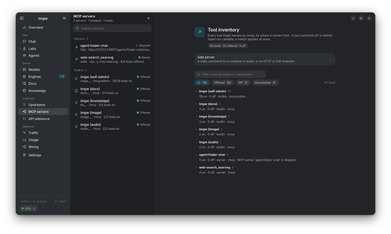</a><br>
      <sub><b>MCP servers</b> · one <code>/mcp</code> endpoint for all tools</sub>
    </td>
    <td align="center">
      <a href="docs/screenshots/api-reference.png">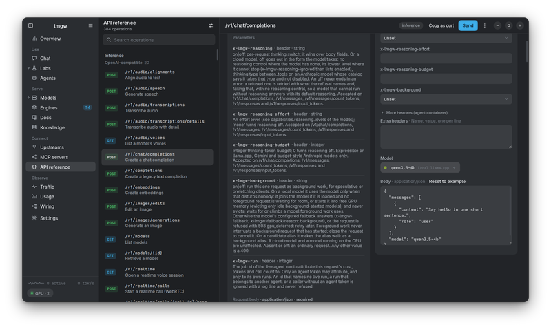</a><br>
      <sub><b>API reference</b> · live OpenAPI docs with a request tester</sub>
    </td>
  </tr>
</table>

<sub>The app window, 1920×1080 at its default 125 % interface scale, with the frame and shadow it draws on Linux. Click a thumbnail for the full image.</sub>

## Features

**Local models**
- **One container per model.** Chat, embedding and rerank models run on llama.cpp or ik_llama.cpp, and decision models on llama.cpp from b11361 on. audio.cpp covers TTS, ASR and a dozen other audio tasks, and stable-diffusion.cpp generates and edits images.
- **VRAM-aware scheduling.** Admission works from measured GPU memory (NVML, or amdgpu sysfs). A model that doesn't fit waits, or pushes out an idle one, and idle models hand their memory back. A row's footprint counts llama.cpp's compute buffers and lays the KV cache out the way llama.cpp does, and a plan that can't fit the card says so.
- **Several graphics cards.** lmgw measures each card on its own and puts each model on one card: of the cards that hold it, the one it leaves least free on, so the large free blocks stay for large models. The model's container gets only that card. A model that doesn't fit pushes out idle models on that card only, and an idle model pushed out starts again on another card that has room for it. A chat model whose context you set and that no single card holds is split over the fewest cards that hold it together. The **GPU pin** in a model's editor keeps it on cards you choose. **Settings → GPU** shows each card's headroom and what the engine costs on it, and the GPU panel shows each card with the models on it. AMD cards and the Windows build's native engines can't be handed a single card yet: their models run on every card they see, as before. See [several graphics cards](#several-graphics-cards).
- **From Hugging Face to a running model.** Download a GGUF together with its projector and draft model, and lmgw proposes llama.cpp settings from the file's metadata. **Find a model** takes a name as someone said it ("qwen 3.6"), a link or a shared model text, and picks the one file that fits your graphics card. The Models page shows the licence the file's header states.
- **Engine builds and benchmarks.** Build engine images from any git ref with pull requests merged in. Benchmarks measure prefill, decode, VRAM and tokens per joule.

**API and routing**
- **Local OpenAI and Anthropic APIs on one port.** `/v1/chat/completions`, `/v1/responses`, `/v1/embeddings`, `/v1/rerank`, `/v1/messages` and more. A client in either dialect can reach any chat model.
- **Decision models.** `/v1/systemone` relays TypeSafe's System One API: a state and typed questions (pick one option, rate on a scale, yes or no), answered with calibrated probabilities instead of generated text. It routes to a local llama.cpp decision model (llama.cpp b11361 or later), recognised from its GGUF header and exposed as `decide/<id>`, or to an OpenAI-compatible upstream such as OpenRouter. lmgw asks an OpenAI-compatible catalog for every output modality, so OpenRouter's decision models (Jev among them), embedders, rerankers and speech, image and video models appear in `/v1/models` under their own tasks. Each lists the lmgw routes that reach it on OpenRouter; image and video models list none, because no lmgw route speaks OpenRouter's image and video APIs. Price sync prices the ones billed per token, decision models and embedders among them. Speech, transcription, rerank, image and video models are billed in other units and stay unpriced until you set a price. An endpoint that refuses the question, such as Gemini's OpenAI-compatible one, gets the option switched off on its upstream.
- **Local or cloud behind one alias.** An alias points at a local model or at an OpenAI-compatible, Anthropic or Gemini upstream. Streaming, tool calls and reasoning get translated in both directions, so switching changes nothing for the client.
- **Model capabilities in `/v1/models`.** Context length, output limit, modalities and reasoning controls, per model.
- **Voice conversations.** `/v1/realtime` speaks OpenAI's Realtime protocol over a WebSocket, and `/v1/realtime/calls` over WebRTC, and answers with a cascade of your own models: turn detection inside lmgw, speech to text, a chat model, text to speech. See [Voice conversations](#voice-conversations).
- **MCP gateway.** Stdio servers (Podman-isolated by default) and HTTP servers sit behind one `/mcp` endpoint, each under its own tool prefix. For upstreams without `/v1/responses`, lmgw runs that API itself, MCP tool calls included.

**Docs and knowledge**
- **Library docs for small models.** A small local model reasons well but hasn't memorised every API. lmgw ingests the documentation of the libraries you use, one corpus per library version, and serves it to any agent as the `docs__resolve` and `docs__query` MCP tools. Search fuses BM25 with embeddings and can rerank. A model picks the chunk boundaries and code copies the text, so every chunk is the original word for word. When an agent finds a library missing, it can ask for it with `docs__request`.
- **Knowledge bases for your own files.** Put PDFs, office documents and spreadsheets into named collections. lmgw extracts the text and embeds it with the model you choose, and scanned pages can go through a vision model for OCR. In Chat, answers cite numbered excerpts that open the passage in its file. Agents can search the same bases through the `kb__*` tools on `/mcp`.

**Devices and clients**
- **Device link.** Paired phones and desktops connect to a separate TLS listener (the HTTP port plus one by default, off until the first pairing turns it on) that serves only paired devices. Pairing pins lmgw's own certificate authority through the pairing link or QR code and enrols a key pair the device made itself, and from then on the device authenticates with its client certificate (mutual TLS). Bearer device keys are gone. A key's policy still decides what the device may reach, including the tools a device hosts itself.
- **Chat feed as a push channel.** `GET /chat/api/feed` streams what changes in Chat, with a keep-alive each device sets for its own connection, so a phone holds one connection open and gets new messages and open approvals without ntfy or any push service.
- **Kai and Kai mobile.** lmgw's own clients: a voice assistant for the Plasma desktop and a native Android app. See [Paired devices and clients](#paired-devices-and-clients).

**Operations**
- **Usage and cost.** Every request is logged with its tokens, latency and price. Charts break it down by alias and key.
- **API keys with policy.** A key can carry alias and tool scopes, a budget, rate limits and a concurrency cap.
- **GPU hold.** A tray switch pauses local models while you need the card for something else. Each model and alias can have its own fallback, of the same model type, and a fallback can have one in turn: a held model's requests go along that chain to the first that can answer. The `x-lmgw-fallback` header names the one that answered, and `x-lmgw-fallback-chain` lists every hop with its reason. An audio model switched to the CPU (its row's "Runs on") takes no VRAM and keeps serving through the hold.
- **Background requests.** A client doing speculative work, such as pre-generating what a user may ask for next, sends `x-lmgw-background: on`. The request then uses a local model only if that disturbs nobody: it shares a model that is already loaded, or starts one into free GPU memory, and never evicts or waits for a model other work is using. Otherwise the model's fallback answers, or a `503` with code `gpu_deferred` says to retry later. Other work never interrupts a background request once it has started; the client cancels one by closing it.

**Dashboard and extensions**
- **Desktop app, remote-ready.** The tray menu covers the GPU hold, starting and stopping models, and updates, and the dashboard opens in a native window. Bind lmgw to your LAN and the same dashboard works remotely in any browser.
- **Rust from gateway to dashboard.** The dashboard is about 88,000 lines of Rust (Leptos), compiled to WebAssembly and built with cargo and Trunk. There's no npm anywhere in the tree. JavaScript is limited to vendored libraries for chat rendering (highlight.js, KaTeX, Mermaid, DOMPurify) and about 700 lines of glue for the window title bar and code blocks.
- **Chat, plus labs for audio, images and documents.** Chat with any alias, with attachments, knowledge bases and MCP tools. Dictate into it, have replies read aloud, or talk with a conversation in voice mode, all on your own speech models (see [Voice in the Chat](#voice-in-the-chat)). The Audio lab and Image lab are playgrounds for the speech and image routes, the Documents lab for the document conversion.
- **Lab store and the Decision lab.** The labs keep their runs on the server, in a store of their own that survives restarts until you delete it. The Decision lab runs `/v1/systemone` questions against a decision model: question sets, set runs with their metrics, and JSONL or CSV export. The Audio and Image labs save the files their runs made, one file as it is or several as a zip with a manifest. Batch agents can classify through a question set too.
- **Self-administration over MCP.** The `lmgw__*` tools on `/mcp/admin` let an agent such as Claude Code inspect and configure the gateway. They stay off until you enable their key, and start out read-only.
- **Agents.** JSON manifests define chat presets, batch pipelines whose results you review before anything gets written, and container agents that bring their own UI.

## How it works

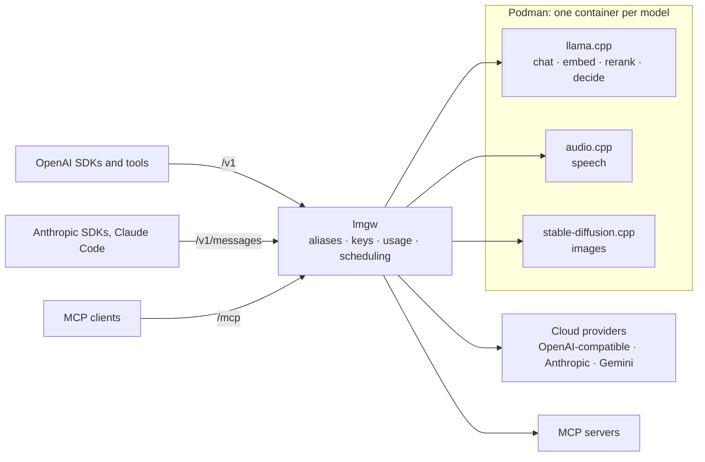

lmgw parses each request into one internal representation and routes it by
alias, and the target's adapter writes it out again in whatever protocol that
backend speaks. State lives in SQLite. Configuration, request logs and usage
go to `$XDG_DATA_HOME/lmgw`, usually `~/.local/share/lmgw`, unless
`LMGW_DATA_DIR` points elsewhere.

## Requirements

- **Linux or Windows, x86_64.** Linux is the main platform: developed and used daily on Fedora, and packaged as an RPM or an AppImage. Windows has a native build with its own installer (see **Install**). There is no macOS build yet.
- **Podman** runs local models and stdio MCP servers on Linux, and the RPM depends on it. Cloud-only use needs no GPU. The Windows build has no Podman: it runs the engines as native processes (see **Install**).
- **NVIDIA GPU** is the tested path. Model containers get the card through `--device nvidia.com/gpu=all --security-opt label=disable` (the default in **Settings → Runtimes**; on a computer with several cards lmgw passes the cards it chose for the model instead, see [several graphics cards](#several-graphics-cards)), so you need the driver plus NVIDIA's container toolkit (the `nvidia-container-toolkit-base` package, from [NVIDIA's repository](https://docs.nvidia.com/datacenter/cloud-native/container-toolkit/latest/install-guide.html)). lmgw writes the card's CDI description itself, without root, into its own runtime directory, writes it again after a driver or package update, and points the containers it gives the card to (models, benchmarks, the probes that read an engine's options, and MCP servers whose run arguments ask for it) at it, so there is no `nvidia-ctk cdi generate` to run for them. Containers you start yourself still read the system's description in `/etc/cdi` or `/var/run/cdi`, and so do lmgw's when the toolkit isn't installed or Podman has no `--cdi-spec-dir` option. lmgw checks at start whether this computer can run local models (the card, its driver, the toolkit, Podman, the model settings) and says in plain words what is missing. The dashboard shows the result on **Settings → GPU** (the "This computer" card), on the Overview and above the Chat's empty state, and the tray gains a "Graphics card needs attention…" item when something needs doing. Where the fix is a package, **Set it up** in the app's window installs NVIDIA's container toolkit (or switches the model settings) after a native confirmation and your password (a polkit prompt) through `lmgw-machine-helper`, a small root helper the RPM installs; **Show the commands** lists exactly what it would run. In a browser the card shows the same commands to type instead, since a remote page can't open a password prompt on your desktop. Through the API the check is the `machine_check` op and the `lmgw__machine_check` tool.
- **AMD** works on a Ryzen APU with Vulkan images and a few changed settings, as [docs/amd-arch.md](docs/amd-arch.md) describes. Self-built Vulkan and ROCm images are untested.

## Install

### Linux

Download the RPM from the [latest release](https://github.com/lmgw-dev/lmgw/releases/latest)
and install it:

```sh
sudo dnf install ./lmgw-*.x86_64.rpm
```

The RPM recommends `poppler-utils` (PDF text) and `tesseract`, which dnf
installs by default; lmgw runs without them, and **Settings → Documents** says
what each optional program adds ([docs/documents.md](docs/documents.md)).

From then on the app checks for new releases in the background and offers to
install them, unless you switch that off under **Settings → Tokens & updates**.
Some releases also carry an AppImage. It's built on current Fedora and needs a
glibc at least that recent. On anything older, build from source.

On Arch Linux, take the `lmgw-*-x86_64.pkg.tar.zst` from the same release
instead:

```sh
sudo pacman -Syu && sudo pacman -U ./lmgw-*-x86_64.pkg.tar.zst
```

The package is listed in the release's `latest.json` under `arch`, but the
in-app updater installs RPMs only and does not install it yet: on Arch you
install each release's package yourself.
[docs/amd-arch.md](docs/amd-arch.md) covers the rest of the Arch setup.

For a server without a desktop there is a Podman image instead, started by a
rootless Quadlet unit, with sign-in accounts and native TLS. It ships as an
OCI archive; [docs/server.md](docs/server.md) covers installing and running it.

### Windows

Download `lmgw_<version>_x64-setup.exe` from the
[latest release](https://github.com/lmgw-dev/lmgw/releases/latest) and run it.
It installs for the current user only, into `%LOCALAPPDATA%\Programs\lmgw`, so it
needs no administrator rights. If the WebView2 runtime is missing, the installer
fetches Microsoft's bootstrapper for it. The installer is not signed yet, so a
browser's download of it carries the mark of the web and SmartScreen warns about
an unknown publisher before it runs. Uninstalling keeps your data: settings and
the database are in `%APPDATA%\lmgw`, models and engines in `%LOCALAPPDATA%\lmgw`.

There is no Podman on Windows. lmgw runs llama.cpp, stable-diffusion.cpp and
audio.cpp as native processes of their upstream Windows builds, which it downloads
from the engines' release pages on first use, checks against a pinned SHA-256 and
unpacks under `%LOCALAPPDATA%\lmgw\engines`. The build is chosen per engine and per
card: CUDA on an NVIDIA card its kernels cover, otherwise Vulkan (which also covers
AMD and Intel cards), and the CPU when no GPU is usable. Cloud-only use needs no GPU.

The app checks the release feed in the background like the Linux one. It downloads
the new installer, checks its SHA-256 before and again right before it starts it, then
quits, installs silently and starts lmgw again.

Not on Windows yet: agents (they run as containers and need Podman), fork and git
builds of engines, text extraction from PDFs (poppler is not shipped), the headless
server image (Linux only), and a dark mode for the tray menu. High-contrast themes,
the Windows 10 theme path, AMD ROCm builds, ARM64 and a signed installer are not
done yet either. The design record is
[docs/design/2026-11-10-windows-native-design.md](docs/design/2026-11-10-windows-native-design.md).

## Building from source

On Fedora, install the toolchain and the Tauri build dependencies. The list
follows Tauri's prerequisites, which is the only reason `openssl-devel` is on
it: lmgw itself doesn't link OpenSSL. `opus-devel` is lmgw's own, for the
system libopus that WebRTC calls link.

```sh
sudo dnf install rust cargo rust-std-static-wasm32-unknown-unknown \
    webkit2gtk4.1-devel gtk3-devel libsoup3-devel librsvg2-devel openssl-devel \
    libayatana-appindicator-gtk3-devel opus-devel rpm-build gcc gcc-c++ make
export PATH="$HOME/.cargo/bin:$PATH"   # cargo installs land here
cargo install tauri-cli --version '^2.0' --locked
# Trunk builds the dashboard. Take its release binary, since building trunk
# from source fails with GCC 16 (ci/install-build-deps.sh also checks the hash).
curl -fsSL https://github.com/trunk-rs/trunk/releases/download/v0.21.14/trunk-x86_64-unknown-linux-gnu.tar.gz \
    | tar -xz -C ~/.cargo/bin trunk
```

Then build and install the RPM:

```sh
git clone https://github.com/lmgw-dev/lmgw.git && cd lmgw
(cd crates/lmgw-ui && trunk build --release)   # the dashboard, embedded into the binary
cargo build --release -p lmgw-machine-helper    # the root helper the RPM packs; build it before the bundle
cargo tauri build --bundles rpm                 # or --bundles appimage on other distributions
sudo dnf install target/release/bundle/rpm/lmgw-*.rpm
```

Arch Linux notes are in [docs/amd-arch.md](docs/amd-arch.md).

## Quick start

1. Start **lmgw** from the application menu. It lands in the tray, and **Open Dashboard** opens the dashboard with you already signed in.
2. Add a model. For a local one, open **Models → Add from Hugging Face**, pick a file and choose **Download & create**. A fresh install keeps the files under `~/.local/share/lmgw/models/`, one folder per kind of model, and **Settings → Runtimes** shows and changes those folders. For a cloud model, add a provider under **Upstreams**.
   To find a model by its name instead, use **Models → Find a model**: it picks the file that fits your graphics card. If a friend sent you a model (their **Send to a friend** button copies a short text with its link), paste it into the Find box. Any Hugging Face link to a model or one of its files works there too.
3. Call it in either dialect. A local model answers to its id, and a cloud model to the name **Models** lists for it (`GET /v1/models` lists every name the gateway answers to). An alias under **Models** is optional: it gives a model a name of your own.

```sh
# OpenAI style
curl http://127.0.0.1:8787/v1/chat/completions \
  -H 'content-type: application/json' \
  -d '{"model": "my-model", "messages": [{"role": "user", "content": "Hello!"}]}'

# Anthropic style, same model
curl http://127.0.0.1:8787/v1/messages \
  -H 'content-type: application/json' -H 'anthropic-version: 2023-06-01' \
  -d '{"model": "my-model", "max_tokens": 512, "messages": [{"role": "user", "content": "Hello!"}]}'
```

Point clients at the gateway. OpenAI SDKs want `http://127.0.0.1:8787/v1` as
their base URL. Anthropic SDKs and Claude Code (`ANTHROPIC_BASE_URL`) want the
bare `http://127.0.0.1:8787`, because they add `/v1/messages` themselves. MCP clients connect to
`http://127.0.0.1:8787/mcp`, for example with
`claude mcp add --transport http lmgw http://127.0.0.1:8787/mcp`.

The self-administration tools live on a separate server at `/mcp/admin`.
Enable the `owner:self-admin` key under **Usage → Keys & budgets**, then send
it as a bearer token (`--header "Authorization: Bearer <key>"`). Two dashboard
pages help here. **Wiring** traces each local chat model from
its download to the name it's served under, and **API reference** documents
the gateway's HTTP API.

### Remote use from a browser

The window is optional. lmgw serves the dashboard itself, and on the same
machine the tray's **Open in Browser** opens it already signed in. Remote
access takes three changes. Set the bind address to `0.0.0.0:<port>` under
**Settings → Network & access**, restart the gateway from the tray, and turn on
**Require gateway API keys on /v1** so the API isn't open to your whole
network. Then open `http://<host>:<port>/` in any browser on your LAN and sign
in with the `owner:dashboard` key, copied from **Usage → Keys & budgets**.

For several people with their own passwords, and for HTTPS so remote browsers
get a secure context, see [docs/accounts.md](docs/accounts.md).

### Paired devices and clients

Three apps are lmgw's own clients. They use the OpenAI-compatible routes where
those fit and lmgw's own API (the Chat feed, the device link, calls bound to a
Chat thread) where they need more:

- **[Kai](https://github.com/lmgw-dev/kai)** is a voice assistant for the KDE
  Plasma desktop. Press a shortcut in any app and talk; everything goes into
  one ongoing conversation in lmgw's Chat that you can also read and continue
  in a browser. It runs no models of its own.
- **[Kai mobile](https://github.com/lmgw-dev/kai-mobile)** is the Android
  client, a native app (Kotlin and Compose around a Rust core), first released
  alongside lmgw 0.5.0. It follows the Chat feed.
- **[Inkference](https://github.com/lmgw-dev/inkference)** is a Firefox
  extension, [on addons.mozilla.org](https://addons.mozilla.org/firefox/addon/inkference/).
  A sidebar chats with your models and can read and operate the page; right-click
  actions summarize, explain, translate or read a selection aloud through
  audio.cpp. Its AI dark mode asks a model to design a theme for each site, then
  measures whether the text on it is still readable. It reaches lmgw over the
  OpenAI-compatible routes with a gateway key rather than the device link, and
  the dark mode works with no model at all.

Kai and Kai mobile pair over the device link. Open **Pair a device…** under
**Usage → Keys & budgets** (in the list's add menu, or on the page shown while
no key is selected) and choose the address the device should use (this computer, the LAN
or WireGuard); if the device listener is off, pairing turns it on (it can also
be switched under **Settings → Network & access → Devices**). lmgw then shows a
pairing link and its QR code. They carry lmgw's CA fingerprint and a one-time token that expires after
ten minutes by default; the device sends the public key of a key pair it made
itself and gets a certificate back. Both sides then show a confirmation code,
and the pairing is complete when you confirm it in lmgw (on the pairing card,
or on the device's page in the list). Apart from
enrolment, the device listener answers only a request that carries a certificate
lmgw issued. It serves the inference routes (`/v1`, `/tokenize`, `/mcp`), the
Chat routes and a device's own `/mcp/host` link, and nothing else: no
dashboard, no `/api`, and no bearer key or cookie.

### Voice conversations

`ws://127.0.0.1:8787/v1/realtime` speaks OpenAI's GA Realtime protocol. The
OpenAI Python SDK's realtime client connects with the same base URL as above
(it turns `http` into `ws`); the JavaScript SDK insists on `wss:`, so there,
pass the URL to a client that takes one, such as the Agents SDK's
`OpenAIRealtimeWebSocket({ url })`. No single model does the talking. lmgw runs a cascade: it detects the turns
itself (Silero VAD, and Smart Turn for `semantic_vad`), transcribes each turn
with a speech-to-text alias, answers with a chat alias and speaks the answer
with a text-to-speech alias. Local models come first, and any stage can be a
cloud alias instead.

Set it up under **Settings → Realtime**. Pick the chat, speech-to-text and
text-to-speech models and a voice. The **GPU memory** card adds up what the
three keep resident together against what lmgw may use on the card, so you
can see whether a larger chat model still leaves room for the voice. The same
page holds the turn-detection and barge-in defaults, the voice prompt and the
connection limits. Once both audio models are set, chat models list
`/v1/realtime` in `/v1/models`. A **speech style** ("calm, warm, unhurried")
goes to a text-to-speech model that reads one, or describes the voice of a
voice-design model, and a session can set its own in
`session.lmgw.speech_instructions`; for a model that makes sounds such as
`[laughter]`, the chat model is told which ones it may write. A model that
reads a style or plain instructions but makes no sounds (Qwen3 CustomVoice,
Auk, MOSS-TTS) gets **delivery cues** instead: a `[laughing]` the chat model
writes at the start of a sentence is sent with the style as how to say the
rest of that sentence, never read out. Cues are a nudge, not a command: the
words themselves weigh more, so a funny line laughs easily and a neutral one
rarely. A cloud TTS gets the style but no cues (gpt-4o-mini-tts ignored
them), unless its alias's `capabilities.speech` override declares
`instructions: "style"`.

Implemented are conversation sessions with audio or text output, PCM16 at
24 kHz, `server_vad`, `semantic_vad` and manual turns, barge-in, client-side
function tools, MCP tools that lmgw runs itself, and WebRTC calls. SIP,
ephemeral keys, the sideband connection, transcription-only sessions and G.711
are not, and the API reference lists the details.

**WebRTC calls.** `POST /v1/realtime/calls` is OpenAI's WebRTC transport for
the same sessions: a client posts its SDP offer with its key (raw
`application/sdp`, or multipart with a `session` part) and gets the answer
back. The audio then travels as Opus over UDP, encrypted (DTLS-SRTP), the
events on the `oai-events` data channel, and
`POST /v1/realtime/calls/{call_id}/hangup` ends a call. OpenAI's browser
example and the Agents SDK's `OpenAIRealtimeWebRTC` (with `baseUrl` pointed at
lmgw and `useInsecureApiKey`) work unchanged. A phone on a cellular link is
what it is for: a lost packet costs 20 ms of concealed audio instead of holding
up the stream behind it, and the client's own echo cancellation and jitter
buffer do their work. lmgw answers with one ICE-lite host candidate, the
address the POST arrived on, and has no STUN or TURN, so the client must reach
that address directly: on the LAN, or through a VPN such as WireGuard. The UDP
port is the HTTP port's number unless **Settings → Realtime → WebRTC calls**
names another, on the HTTP listener's address; for clients on other machines,
open that UDP port beside the TCP one. A paired device calls through the device
listener and uses its port, TCP and UDP. The same group shows each socket and
the live calls with their round trip and playout. A call bound to a Chat thread
or folder (`chat_thread`, `chat_folder`) carries lmgw's own events beside
OpenAI's, which lmgw's own clients read. `scripts/webrtc-interop.sh` runs
Chromium's libwebrtc against a scratch gateway to check all of it.

**MCP tools on `/v1/realtime`.** A session can use the tools of the MCP
servers lmgw serves on `/mcp`, and of the built-in `docs` and `kb` toolsets.
Name them by label in `session.update`:

```json
{"type": "session.update", "session": {"type": "realtime", "tools": [
  {"type": "mcp", "server_label": "docs"}
]}}
```

`GET /v1/mcp/servers` lists the labels a key may use, and
`GET /v1/mcp/servers/{label}` the tools behind one, so a client can offer a
picker. A label is resolved against lmgw's own servers under the key's tool
scope; a `server_url` in the tool is ignored, so lmgw never connects where a
client points it. The session announces each label's tools as an
`mcp_list_tools` item. When the model calls one, lmgw runs it before the
response ends and reports it as an `mcp_call` item with its output. As in
OpenAI's Realtime API, the call ends the response, and the client sends
`response.create` to get the answer; the OpenAI Agents SDK
(`hostedMcpTool`) does that by itself. Tools behind an approval
(`require_approval`) are not supported yet. Voice mode in the Chat uses the
thread's own MCP tools instead.

### Voice in the Chat

<table>
  <tr>
    <td align="center" width="50%">
      <a href="docs/screenshots/chat-voice-panel.png">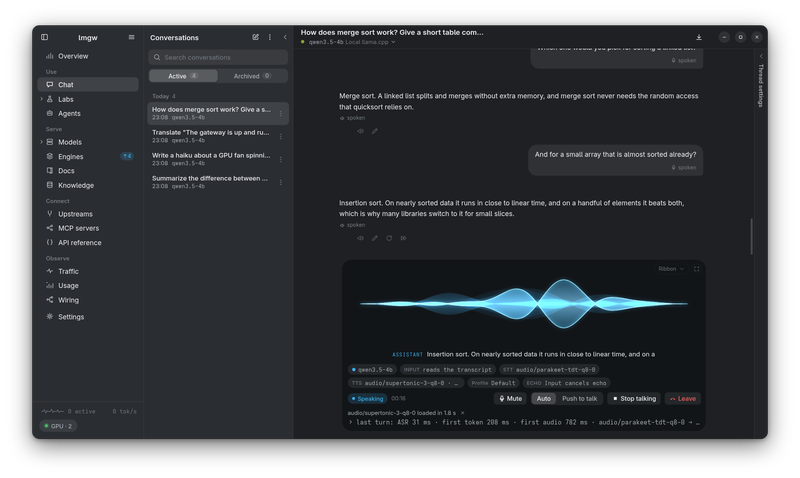</a><br>
      <sub><b>Voice mode</b> · the panel in the composer's place</sub>
    </td>
    <td align="center" width="50%">
      <a href="docs/screenshots/chat-voice-focus.png">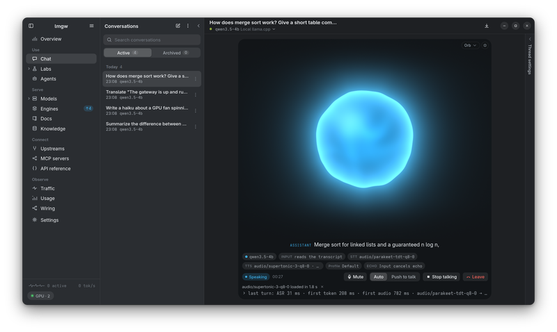</a><br>
      <sub><b>Focus view</b> · the orb while the voice speaks</sub>
    </td>
  </tr>
  <tr>
    <td align="center">
      <a href="docs/screenshots/chat-voice-menu.png">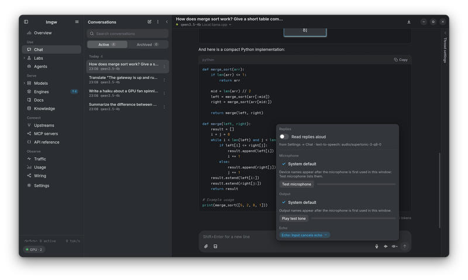</a><br>
      <sub><b>Voice menu</b> · read-aloud and the window's audio devices</sub>
    </td>
    <td align="center">
      <a href="docs/screenshots/settings-chat-voice.png">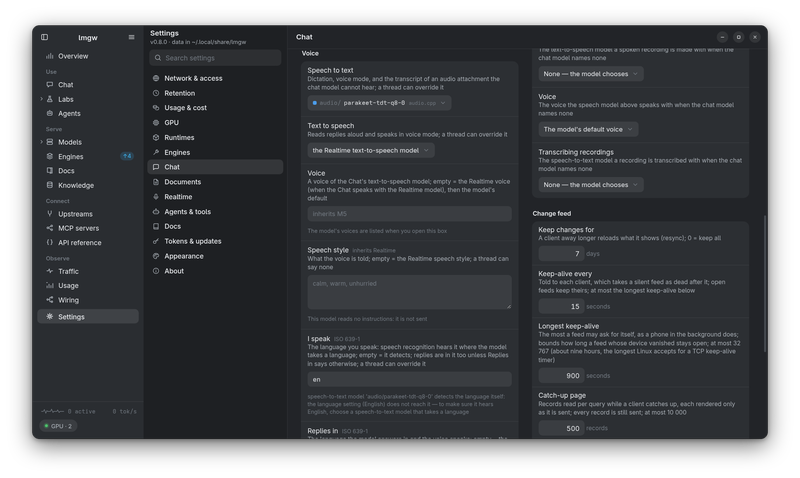</a><br>
      <sub><b>Settings → Chat → Voice</b> · the defaults every thread inherits</sub>
    </td>
  </tr>
</table>

The Chat listens and speaks with your own speech models, through the same
pipeline as `/v1/realtime`. **Settings → Chat → Voice** sets the defaults: the
speech-to-text and text-to-speech models, the voice and its speech style, the
language you speak (what speech recognition hears where the model takes a
language) and the language replies are in (what the model answers in and the
voice pronounces; empty follows the language you speak, so you can speak German
and hear English), with a note where a model cannot take its language, whether replies are read aloud, and how voice
mode hears the end of a turn (Smart Turn, silence, or push-to-talk). An empty model, voice or
style falls back to **Settings → Realtime**, so a configured realtime cascade
serves the Chat as well. A thread overrides any of these in its settings
drawer, and a folder's defaults hand their overrides to the threads created in
it. Nothing loads when a chat opens. The speech-to-text model loads when you
press the microphone, the voice when something is first read, and all three
models when voice mode starts. Each load goes through the same VRAM admission
as a request, so a press may push an idle model out. Under the GPU hold the
controls turn amber and say beforehand which fallback would hear or speak, and
a fallback that answered is named on the message.

- **Dictation.** Click the microphone to start and stop, or hold it, or hold
  **Right Ctrl** anywhere on the page. The transcript lands at the caret for
  editing and nothing is sent before Enter. Esc discards the recording.
- **Read-aloud.** The speaker under a reply reads it. **Read replies aloud**
  in the composer's voice menu reads each new reply as it streams, from its
  first sentence. Code blocks and tables are not read out; the voice says
  "Code block, rust." or "Table." instead.
- **Voice mode.** The waveform button next to the microphone swaps the
  composer for the voice panel. In automatic mode lmgw hears when you start
  and stop, you can talk over the voice to interrupt it, and **Space** stops
  the voice. In push-to-talk mode you hold **Space** (or the Talk button)
  while you speak. **M** mutes and **Esc** leaves. An interrupted reply keeps
  what you heard in the thread's history, and the unheard rest stays greyed
  in the bubble. Captions follow the voice, chips show the chat, speech and
  voice models (a change applies from the next turn), and each spoken reply
  gets a timing line: speech recognition, first token, first audio, and the
  models that served. The visualisation is a ribbon, an orb or a ring, picked
  per window, and the focus view gives the panel the whole column. Turns are
  written into the thread as you speak, so the conversation carries on in
  text whenever you like. Voice mode is not available in Admin Chat threads,
  though dictation and read-aloud are.
- **Models that hear (experimental).** Set **Audio input in voice mode** to
  *on* in Settings → Chat → Voice or in a thread's drawer, and a chat model
  that takes audio input (Gemma 4 with its audio projector, say, or a cloud
  model whose capabilities list audio) gets each spoken turn as audio while
  the speech-to-text model transcribes it beside. The reply starts at once
  but plays only when the transcript is in: the transcript is what the thread
  keeps, and a turn that turns out to be noise ends quietly. When the GPU
  hold or a busy card hands the turn to a fallback, that fallback hears it if
  it takes audio and reads the transcript otherwise (a busy card is noticed
  only at the send, so a fallback that reads text answers a moment later,
  from the transcript). A model whose capabilities lmgw cannot read reads the
  transcript until you give its alias a capabilities override with task chat
  and input modalities text and audio (a passthrough model needs an alias for
  that). The voice panel's INPUT chip says whether the
  model hears you or reads the transcript, and why. No audio is stored.
- **Audio devices.** The voice menu holds the microphone, the output and the
  echo mode, kept per window. The default expects an input that cancels echo
  itself, such as a USB mic array with echo cancellation or a PipeWire
  echo-cancel source, with lmgw playing on the system default output, so
  you get full duplex with barge-in. Browser echo cancellation, headphones
  and half duplex are the other modes. In the app window the microphone needs
  no prompt, and lmgw moves only its own playback to the chosen output
  through PipeWire (that needs `pipewire-utils`; other programs stay where
  they are). A browser asks for the microphone itself and offers it only in
  a secure context (`localhost` or https, not a LAN address over plain http).
  There the outputs are the browser's own: Chromium plays on the one you
  choose, Firefox only on the system default.

No audio is stored. A spoken turn is kept as text, together with how it was
spoken.

### Several graphics cards

On a computer with more than one card, lmgw keeps the books per card. What
follows is for NVIDIA cards, which lmgw can hand to a container one by one.

- **Where a model goes.** lmgw puts each model on one card: of the cards that
  hold it now, the one it leaves least free on. Where none does, it stops
  idle models on one card to make room, the fewest it can. Its container is
  started with that card alone, by the card's UUID (`--device
  nvidia.com/gpu=GPU-…` and `NVIDIA_VISIBLE_DEVICES`), in place of the
  cards the run arguments pass. A container that already has exactly the
  cards its run arguments pass keeps them as written.
- **A model too large for one card.** A chat model whose context is set (the
  context field, or `-c` in its arguments) and that no card holds is split
  over the fewest cards that hold it together. lmgw tells llama-server the
  layers each card gets (`--split-mode layer --tensor-split`) and charges
  each card its part. An engine image whose `--help` doesn't list those
  options can't be split: the model waits or is refused, and says why. A
  chat model with no context set stays on one card, with the largest
  context that card holds: set a context to spread it over several.
  Embedding, rerank, decision, speech and image models always go on one
  card; one larger than every card is refused.
- **Making room.** A model that needs room pushes out idle models on the
  card it goes on, never on another. An idle model pushed out starts again
  on another card that has room for it now, keeps its place in the
  unloading order, and says where it came from on the Models page. It is
  not moved again before a request has used it.
- **Choosing the card yourself.** The **GPU pin** in a model's editor lists
  the cards; tick one or more to keep the model on them. A pinned model
  whose cards are gone does not start on another card; its fallback
  answers. Run arguments that name a card (`--device nvidia.com/gpu=1`,
  `-e NVIDIA_VISIBLE_DEVICES=1`) count as a pin too. The line under the
  command line says where the model would start now.
- **A split of your own.** A chat model whose arguments set
  `--tensor-split` keeps it where its GPU pin has as many cards as the
  split has entries: lmgw starts it on those cards, the entries in the
  order of the cards' PCI addresses, with its arguments as written, and
  charges each card its share. Without such a pin lmgw places it as any
  model and starts it without `--tensor-split`, and without `--split-mode`
  and `--main-gpu` beside it. The line under the command line and the
  start's warnings say so. An embedding, rerank or decision model's own
  split is never kept: those run on one card.
- **Fit marks.** **Find a model** and the Hugging Face file list measure a
  file against the card with the most room for lmgw now, and name it
  ("fits on card 2"). Beside that mark each file shows two badges, judged
  at the context Get it would create (shown beside them):
  **Min. cards**, the fewest cards whose total memory holds it ("2 of 4"),
  and **Free VRAM**, whether the cards it would use have room now (a tick),
  after lmgw unloads its idle models there (a "!", the models named), or not
  (a cross, with what it needs against what is there: "needs 21 GiB, card 2
  has 18"). A mixture-of-experts model that no card holds whole shows a
  third, "with experts in RAM: 1 card". The figures per card are in the
  card's **Per card** fold and in the file list's tooltip. One card hides
  Min. cards; a GPU memory budget shows "budget" with a tick or a cross in
  its place. An embedding, rerank or decision model that only a split would
  hold says "fits only split" and that it runs on one card; so does a chat
  model whose engine can't be told a split, with the reason. The finder still
  recommends the best file one card holds.
- **Get it asks.** Get it on a file that one card holds at its full context
  sets it up as before. On a file that only a split (or its experts in RAM)
  holds at its full context, lmgw doesn't choose: Get it lists the ways with
  their numbers — split over cards 2 and 3 at the full context with the GiB
  on each, one card at a shorter context with the tokens it gets, and the
  experts in RAM where that applies — and downloads nothing until you pick
  one. `lmgw__model_get` answers the same as `choices` and takes the pick as
  `layout`.
- **Waiting.** A request that waits for room says which card it waits for
  and which model it unloads there, on the Traffic page's GPU panel and in
  the Chat's image and speech calls. A refusal names the card that was
  short. Another model that fits a different card starts meanwhile.
- **Headroom: room for other programs.** On each card lmgw keeps a floor
  free for other programs (the **Floor per card**, 1 GiB by default), but
  no more than the most they used on that card in the last 7 days: a card
  nobody else uses keeps nothing. On top it keeps the room they used
  beyond what they hold now (they used 41 GiB, they hold 22 now: 19 GiB
  more). A model still starting, or not measured yet, gets a margin on
  top for what its estimate may miss (327 MiB for a llama.cpp model, as
  much as its files for a voice model whose memory isn't learned yet). The
  learned room and the margin are given up last: lmgw puts a model on
  another card, unloads its own idle models, waits for them, or fits a
  model that can run with less smaller first, and only then starts beside
  the floor alone, with a warning that says what it went without. Whether a
  model is too large counts the floor, never the room or the margin, so a
  model that fits beside the floor always gets to start (a voice model
  gets its first request and is measured); if its estimate runs low, that
  comes out of the floor. **Settings → GPU** says per card what is kept
  and why, and **Keep free for other programs** sets a card to **Always**
  an amount (never given up: a model that needs it waits, goes elsewhere
  or falls back) or **Nothing** (the card is lmgw's); where other programs
  used more than now, it suggests an amount — the floor and that room
  together, since Always replaces the floor. **Forget…** drops a card's
  readings.
- **The engine's cost.** **Settings → GPU** shows what the engine itself
  takes on each card: learned once a model has run on that card alone,
  640 MiB on an NVIDIA card until then.
- **Not yet.** AMD cards, a GPU node in a row's run arguments
  (`--device /dev/nvidia0`) and the Windows build's native engines can't be
  handed a single card: their models run on every card they see, as one
  group. A model is not fitted smaller over several
  cards, an aux, speech or image model is not split, and an idle model is
  not moved unless a request needs its room. Benchmarks still run on every
  card the run arguments pass. The design record is
  [the device ledger](docs/design/2026-11-13-device-ledger-design.md).

### Network and access defaults

- The gateway listens on **`127.0.0.1:8787`**, loopback only. **Settings → Network & access** changes that after a restart.
- `/v1` and `/mcp` accept requests **without a key** until you turn on **Require gateway API keys on /v1**. Turn it on before you bind to anything but loopback. Keys live under **Usage → Keys & budgets**.
- The dashboard and its `/api` need an owner credential, either a session cookie or an owner key. The tray window signs itself in, and every start logs a login link.

## Documentation

| Document | Covers |
| --- | --- |
| [lmgw-dev.github.io](https://lmgw-dev.github.io/) | The project site |
| [docs/agents.md](docs/agents.md) | Writing agents: manifests, batch pipelines, container agents |
| [docs/backends.md](docs/backends.md) | Building and pinning engine images for llama.cpp, ik_llama.cpp, audio.cpp and stable-diffusion.cpp |
| [docs/amd-arch.md](docs/amd-arch.md) | Running on Arch Linux with an AMD Ryzen APU |
| [docs/server.md](docs/server.md) | Running lmgw headless on a server: the Podman image, its rootless Quadlet unit, TLS, accounts, updates and migrations |
| [docs/accounts.md](docs/accounts.md) | Sign-in accounts on the desktop, and its TLS listener for sign-in from other machines |
| [docs/documents.md](docs/documents.md) | What lmgw turns into text, the optional programs it uses (poppler, tesseract, …) and the Settings → Documents page |
| [docs/design/](docs/design/) | Design records for each major feature |
| [examples/agents/folder-chat](examples/agents/folder-chat/README.md) | A complete container agent that chats with a folder of documents |

The dashboard's **API reference** page is generated from the running
gateway's own OpenAPI document (`/api/openapi.json`), so it matches the
installed version.

## Development

```sh
(cd crates/lmgw-ui && trunk build)   # dashboard bundle, read from disk by debug builds
scripts/dev-instance.sh               # headless gateway on a scratch data dir, 127.0.0.1:8899
(cd crates/lmgw-ui && trunk watch)    # rebuild the dashboard on change, no restart needed
bash ci/check.sh                      # rustfmt, clippy, the dashboard build and the test suite
bash ci/check.sh --changed            # the fast tier: only what the diff against main touches
```

To run the gate (or any long command) in the background, start it with
`scripts/long-run.sh target/ci.log scripts/build-slot.sh bash ci/check.sh` and wait on it with
`scripts/long-wait.sh target/ci.log`: each wait call blocks for up to nine and a half minutes and
reports log growth and CPU use, so a running job is told apart from a stuck one.
The check before landing is `scripts/long-run.sh target/land.log scripts/land-check.sh`: it runs
the gate and the Windows compile check (`LMGW_WIN_HOST` set) at the same time and prints one
verdict line for each and an overall exit status.

`ci/check.sh` runs the suite under [cargo-nextest](https://nexte.st) when it is
installed (`cargo install cargo-nextest --locked`): every test in a process of
its own, known flakes retried and named in the summary (`.config/nextest.toml`
says which and why). Without it the script falls back to `cargo test
--workspace` and says so. `--changed [base]` prints what it selected and why:
the touched crates' tests, the `tests/it` modules that `ci/it-map.toml` maps the
diff to, and a smoke set; the dashboard build and the worklet check run only
when their inputs changed. The narrowing needs nextest (without it, `--changed`
runs the whole suite), and the full run stays the check before a merge.
Under nextest a setup script (`scripts/nextest-test-env.sh`) lets lmgw-core's
`tests/it` processes share one build of the admin API document per run and hash
passwords with argon2's smallest parameters; `.config/nextest.toml` explains both
and what they saved. Plain `cargo test` builds and hashes as the app does.

### Podman under SELinux

Every rootless container start runs `pasta`, Podman's network helper, in a
confined SELinux domain. Whatever that domain may not use becomes an AVC
denial, and on a desktop each denial is a setroubleshoot notification. Three
rules keep container starts quiet:

- **Spawn `podman` through `lmgw_core::child::system_tool`** (or
  `system_tool_tokio`). The child inherits no descriptor beyond stdio, so the
  desktop app's open WebKitGTK and GPU files never reach `pasta`. It also gets
  no `LD_LIBRARY_PATH`, so the target directory cargo puts there and an
  AppImage's mount stay out of `pasta`'s loader search. A child that is not a
  system tool gets `child::stdio_only`. The working directory doesn't matter.
- **Never bind-mount the checkout, a worktree or a parent directory with `:Z`
  or `:z`.** The relabel is recursive and stays after the container is gone:
  the whole tree becomes `container_file_t`, which `pasta` and other confined
  tools may not search. Copy what a tool needs into a directory of its own
  under `target/` and mount that. `restorecon -RF <checkout>` puts the default
  labels back after an accident.
- **Hold a lock around a command with `flock -o FILE cmd`.** Plain `flock`
  hands the lock's descriptor to the command and to every container it starts.

### Typed answers

lmgw's own API (Chat, knowledge, the labs, the agent run API, the dashboard
and admin routes, ops) is typed end to end: every answer, op result, SSE frame
and request body is an `lmgw-api-types` type that the handler or op itself
builds or parses, and the OpenAPI schema is generated from that type; drift
tests check the description against the wire. The exceptions are named: verbatim
relays of another program's JSON (listed with the reason in `UNTYPED`,
`crates/lmgw-core/src/openapi/exclusions.rs`) and file downloads.

The `/v1` protocol routes (OpenAI, Anthropic, llama.cpp, MCP) follow those
protocols, so their request and response schemas are written by hand
(`json_schema!` in `crates/lmgw-core/src/openapi/v1`) and their handlers pass
JSON through; they are held to the protocol, not to an lmgw type. System One
(`POST /v1/systemone`) is the `/v1` protocol whose schema comes from
`lmgw-api-types` (`systemone`): lmgw is itself a client of that wire, so one
type set describes it and serves lmgw's own callers. The handler still relays
the bytes as sent, and drift tests hold the types to llama.cpp's, TypeSafe's
and OpenRouter's answers.

Two checks enforce the rule for the rest:

- `untyped_responses_are_exactly_the_allowlist` (a unit test in
  `crates/lmgw-core/src/openapi/build.rs`) walks every operation of the
  OpenAPI description: each response in every content type, each SSE event
  frame and each request body, with `$ref`s resolved. It fails when one is
  untyped (`Resp::Untyped`, or a free-form object: `{}`, `true`, an object
  with neither `properties` nor typed `additionalProperties`) and the
  operation is not on `UNTYPED`, or when an `UNTYPED` entry no longer is.
- `ci/json_ratchet.py` counts inline `json!` macros in the non-test code of
  `crates/lmgw-core/src/web/` and `ops/` (the handlers and ops, not the
  knowledge, chat or server modules) and compares the count with
  `ci/json-ratchet.toml`. Inline JSON is being ratcheted down: it fails above
  the baseline (build the answer from an api-types type instead) and below it
  (lower the baseline in the same commit), so the number only ever falls.
  `--verbose` prints the per-file counts. It runs in `ci/check.sh` and in the
  `fmt` job of the CI workflow.

For a new answer, add a drift test: call the live route, read the body into
its type, write it back and compare with the live JSON (`round_trips` in
`crates/lmgw-core/tests/it/common/mod.rs`; see
`tests/it/chat_threads_wire.rs`). A field the handler adds without adding it to
the type then fails the test.

Linking with [mold](https://github.com/rui314/mold) is optional. Rust already
links this target with its bundled rust-lld; mold took 1.2 s instead of 2.0 s
for the `tests/it` binary, a small part of a rebuild. To use it, install
`clang` and `mold` and create an untracked `.cargo/config.toml`:

```toml
[target.x86_64-unknown-linux-gnu]
linker = "clang"
rustflags = ["-C", "link-arg=-fuse-ld=mold"]
```

Keep it out of git with `echo .cargo/config.toml >> .git/info/exclude`. It
covers only the host target, so Trunk's wasm32 build keeps rust-lld, and the
first build after adding or removing it rebuilds everything. Dev builds keep
line tables only (see `Cargo.toml`), so backtraces name every file and line;
for a debugger session, build with `CARGO_PROFILE_DEV_DEBUG=full`.

`scripts/dev-instance.sh` runs a dev instance with its own container names and
a scratch data directory, so your real data stays out of reach. `cargo tauri dev`
starts the full desktop app instead, and a debug build is always a dev run: it
needs `LMGW_DATA_DIR` (a copy from `scripts/dev-copy.sh copy`, or a dir
`scripts/dev-instance.sh` has booted once), refuses the installed app's data
directory and a dir still on the production container prefix, runs beside the
installed app rather than handing over to it, keeps its own webview store in
`<data dir>/webview`, plays its audio as `lmgw-dev`, keeps its tray icon's files
in `<data dir>/tray-icon`, builds its window only on a port it holds, and runs no
updater. There is no switch to point a debug build at your real data.
`scripts/dev-guards-check.sh` checks these refusals under a fake home directory.
A dev copy does not resume the installed app's Hugging Face downloads, and a dev
instance refuses to write into a models directory outside its own data dir:
downloads, retries, deletes and voice-library edits answer `dev_shared_models_dir`,
and an image start skips creating its LoRA and upscaler dirs there. To test those,
point the copy's models dir at a folder inside its data dir. A row's own extra run
args and an agent you re-enable in a copy still reach production's paths.

Your real data dir belongs to the installed app (the RPM; on Arch, the release's
package `docs/amd-arch.md` describes). Do not run a work-in-progress build on it:
`cargo run --release` opens `~/.local/share/lmgw` and applies that tree's
database migrations, which are one-way, so an older installed app refuses to
start afterwards.

`scripts/shell-check.py` checks the window's microphone permission and the voice
output routing in the real shell, on a hidden display, with mock microphones and
a private audio graph.

The workspace has six members:

| Crate | Role |
| --- | --- |
| `crates/lmgw-core` | The gateway as a library: API parsers, protocol adapters, routing, container runtime, MCP plane, SQLite store, dashboard API |
| `crates/lmgw-ui` | The dashboard, a Leptos single-page app compiled to WebAssembly |
| `crates/lmgw-api-types` | Types shared by the dashboard and its API |
| `crates/quickdoc-core` | Versioned documentation corpora with hybrid retrieval |
| `src-tauri` | The tray app and window |
| `examples/agents/folder-chat` | Example container agent |

Releases are tagged. `scripts/release.sh 0.4.0` sets the version, commits it
and creates the tag `v0.4.0`, and the tag's message becomes the release notes.
Pushing the tag builds the RPM and publishes the release.
This repository receives one squashed commit per publish: `scripts/publish-github.sh`
copies an audited, scanned tree onto the public tip, and `--tag` puts the release tag on it.

## License

lmgw is under the MIT License ([LICENSE.md](LICENSE.md)). The dashboard
bundles KaTeX, Mermaid, DOMPurify and highlight.js, each under its own license, in
[crates/lmgw-chat-ui/assets/vendor](crates/lmgw-chat-ui/assets/vendor/). The gateway
embeds the Silero VAD model (MIT) from
[crates/lmgw-core/assets/realtime](crates/lmgw-core/assets/realtime/) and links
ONNX Runtime (MIT) to run it. Their licences and ONNX Runtime's third-party
notices are in that folder, and the RPM and AppImage install them under
`/usr/share/licenses/lmgw/`.
